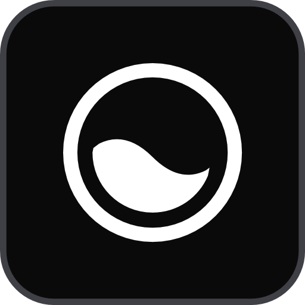

<p align="center">
  
</p>

<h1 align="center">Tidal</h1>

<p align="center">
  Brightness control for every monitor on Windows.<br>
  <a href="https://tidal-lemon.vercel.app">Website</a> ·
  <a href="https://github.com/EzraBuild/Tidal/releases/latest/download/Tidal-win-Setup.exe">Download for Windows</a> ·
  <a href="https://github.com/EzraBuild/Tidal/releases">Releases</a>
</p>

A Windows tray app for controlling external monitors: hardware brightness and contrast over DDC/CI,
the built-in laptop screen through WMI, adaptive brightness, software dimming, per-app brightness,
hotkeys, and input switching. Inspired by Lunar for macOS; written from scratch.

## Download

**[tidal-lemon.vercel.app](https://tidal-lemon.vercel.app)**, or grab `Tidal-win-Setup.exe` from the
[latest release](https://github.com/EzraBuild/Tidal/releases/latest). It installs per user (no admin
rights) on 64-bit Windows 10 (2004+) and 11. The preview isn't code-signed yet, so SmartScreen may
warn on first run: choose **More info → Run anyway**.

## Status

| # | Feature | State |
|---|---------|-------|
| 1 | Detect monitors; read/write brightness and contrast (DDC/CI, WMI) | Done |
| 2 | Tray popup with per-monitor sliders and "link all" | Done |
| 3 | Global hotkeys with per-monitor min/max | Done |
| 4 | Adaptive brightness: sunrise/sunset schedule, sync from built-in screen / light sensor | Done |
| 5 | Input source (VCP 0x60) and volume (VCP 0x62) | Done |
| 6 | Software dimming below 0% / for monitors without DDC/CI | Done |
| 7 | Per-app presets | Done |
| 8 | JSON settings, start with Windows | Done |

## Layout

```
src/Tidal.Core         What Tidal does on any operating system: plain .NET, no UI, no OS calls
  Displays/            Display model, the detector interface, DDC/CI displays (each OS supplies the
                       channel), write throttling, limits, software dimming levels, capabilities parsing
  Adaptive/            Sun position (NOAA equations), level curves, the sun source, and the base
                       classes for the built-in screen and light sensor sources
  Hotkeys/             Shortcut parsing and formatting
  Settings/            Settings model and JSON store
src/Tidal.Windows      Windows hardware
  Native/              P/Invoke: user32 (monitor enumeration, CCD) and dxva2 (DDC/CI)
  Displays/            Detection, the DDC/CI channel (dxva2) and WMI brightness
  Adaptive/            Built-in screen (WMI) and light sensor (WinRT) sources
  Startup/             The command Windows runs at sign-in
src/Tidal.Linux        Linux hardware (no Linux app yet)
  Native/              libc calls for i2c-dev
  Displays/            Detection (DRM outputs, EDID), DDC/CI over I2C, backlights through sysfs or logind
  Adaptive/            The built-in screen's backlight as a source
src/Tidal.ViewModels   What the popup and Settings show and do, for any UI framework: the display
                       list ("link all" lives here), adaptive brightness, app presets, shortcuts,
                       updates, settings persistence
  Platform/            What each app supplies: display change events, adaptive sources and location,
                       hotkeys, open apps and icons, start at sign-in, the file manager
src/Tidal.App          WPF tray app for Windows (WPF-UI controls, restyled: monochrome, square, Geist fonts)
  Tray/                Notification-area icon, the brightness popup, the logo
  Osd/                 On-screen brightness indicator for shortcuts
  Themes/              Tidal's palette (light/dark) and control styles: pill slider, chips, tabs, tiles
  Controls/            Shortcut recorder, number dial, day curve chart, mode picker
  Services/            The Windows side of Platform/, plus software dimming overlays and app presets
  Interop/             Win32 for the tray icon, popup placement, hotkeys and the dimming overlay
tools/Tidal.Diag       Console diagnostics: what each display supports (Windows or Linux)
tests/Tidal.Core.Tests Unit tests: throttling queue, DDC/CI displays, capabilities parser, limits and
                       dimming below 0, app presets, shortcuts, settings store, sun times, adaptive curves
tests/Tidal.ViewModels.Tests  Link all, software dimming, app presets, start at sign-in, UI timer
tests/Tidal.Windows.Tests     Interop struct sizes, startup command
tests/Tidal.Linux.Tests       Detection on made-up machines, DDC/CI framing, EDID, backlights, libc calls
```

### How detection works

On Windows, `WindowsDisplayDetector` joins three views of the same hardware:

- **GDI monitors** (`EnumDisplayMonitors`) give bounds, the primary flag, and DDC/CI handles via
  `GetPhysicalMonitorsFromHMONITOR`.
- **CCD display paths** (`QueryDisplayConfig`) give real model names, a stable device path (used as
  the display's settings ID) and the connection type, which tells built-in panels apart.
- **WMI** (`root\WMI` `WmiMonitorBrightness`) provides brightness for built-in panels, matched to a
  display by PnP instance path.

On Linux, `LinuxDisplayDetector` reads the kernel's graphics outputs in `/sys/class/drm`:

- Each connected, enabled output's **EDID** gives the monitor's name and identity.
- The **I2C bus** the driver links to the output (its `ddc` link, or the DisplayPort AUX channel
  under it) carries DDC/CI, which Tidal speaks itself through `/dev/i2c-N`. For drivers that don't
  link buses (NVIDIA's), Tidal reads the EDID on each graphics card bus and matches it.
- **Built-in screens** use `/sys/class/backlight`: written directly where the user may, otherwise
  through systemd-logind, which lets the signed-in user set it without root.

The kernel doesn't know how the desktop arranges displays, so on Linux the bounds are placeholders.

Each display becomes a `DdcDisplay`, `WmiDisplay` or `UncontrolledDisplay`. Displays without
hardware control expose a `Note` explaining why (DDC/CI off in the monitor menu, dock or adapter in
the way, wireless connection and so on), and Tidal dims them in software instead.

### Software dimming

Software dimming lays a black, see-through window over a display (`DimOverlay`): clicks pass
through it, it never takes focus, and it's excluded from screenshots and screen sharing. It's a
plain Win32 layered window with a constant alpha, so it costs nothing to draw, and it disappears
with the process, so a crash can't leave a screen dark. At most it's 70% black
(`SoftwareDimming.MaxOpacity`). `DimmingService` keeps it above other always-on-top windows (the
taskbar rises over it when clicked) while Tidal's popup and level indicator stay above it.

### Throttling

All I/O for a display goes through its own `DeviceCommandQueue`, a dedicated thread that:

- coalesces writes per VCP code, so dragging a slider sends only the latest value once the monitor
  is ready,
- waits at least 50 ms between DDC/CI commands, and
- retries reads and writes that fail; I2C errors happen now and then.

## Using Tidal

Tidal runs in the notification area (on Windows 11 it starts in the "Show hidden icons" flyout;
drag it onto the taskbar to keep it visible).

- **Click the icon** to open the brightness popup: a slider per display (the mouse wheel moves it),
  the adaptive mode picker, presets (0–100% of each display's range), Link all, Settings and Quit.
  Click elsewhere or press Esc to close.
- **Inputs and volume**: monitors that list their video inputs get an input pill (e.g.
  "DisplayPort 1") under their slider and on their Settings tab; choosing another input makes the
  monitor show that device instead of this PC. Monitors with speakers get a volume slider.
- **Settings** has a tab per display (brightness MIN / CURRENT / MAX as big numbers you can scroll,
  type or arrow-key, contrast, and the display's Adaptive switch), an Adaptive tab with today's
  brightness curve, and a Shortcuts tab.
- **Link all** moves every display to the same relative level as the slider you drag, within each
  display's own limits (so with no limits set, they all get the same value).
- **Brightness shortcuts** work in any app: Ctrl+Alt+PageUp / Ctrl+Alt+PageDown by default, 5% per
  press, hold to repeat. A small indicator shows the new level on each display that changed. They
  can change every display or only the one under the mouse pointer.
- **Limits**: each display can have a lowest and highest brightness. Sliders, shortcuts and Link all
  stay inside them; "brighter" never dims a display that was set above its limit by other means.
- **Dim below 0**: a per-display switch in Settings. The slider and shortcuts then go past the
  lowest brightness to -50, keeping the backlight at its lowest and darkening the picture in
  software. Shortcuts pause at the lowest brightness on the way down. Displays Tidal can't control
  (no DDC/CI) get a brightness slider that is software dimming all the way. Software dimming saves
  no power, and the Windows Start menu and other system flyouts aren't dimmed.
- **Adaptive brightness** moves displays automatically. Pick one source in Settings:
  - *Follow the sun*: dim at night, brightest at the day's highest sun, computed locally from your
    location (type it, or let Windows fill it in).
  - *Match the built-in display*: external displays follow the laptop screen, however it changes
    (Fn keys, the Windows slider, Windows' own automatic brightness).
  - *Follow the light sensor*: on PCs with an ambient light sensor.

  Each display has its own Adaptive switch (on for external displays by default) and follows the
  level within its limits, so limits double as calibration. Changing a display yourself while
  adaptive is on keeps your change as an offset; Settings shows it with a Reset button.
- **App presets** (the Apps tab in Settings): give an app its own brightness, as a percentage of
  each display's range. While the app is in front, the display showing it switches to that
  brightness (every display with Link all on) and goes back when you switch away; adaptive
  brightness waits meanwhile. Add apps from the ones that are open, or browse for a program.
  Tidal's own windows, the taskbar and the Start menu don't count as switching away.
- **Right-click the icon** for Settings (contrast, limits, adaptive brightness, dimming below 0,
  app presets, shortcuts, start with Windows, why a display can't be controlled), detecting
  displays again, and Quit.
- Hovering the icon shows each display's brightness.
- **Start with Windows** (the General tab in Settings): Tidal adds itself to the current user's
  Run key, so it starts in the tray when you sign in, without the popup. It's on after a fresh
  install and removed again on uninstall. If it's turned off in Windows' Startup apps (Settings or
  Task Manager), the General tab says so. The tab also shows the version and the settings file.
- **Updates**: an installed Tidal checks its GitHub releases a minute after starting and every six
  hours, downloads a new version in the background, and shows "Update ready" in the popup.
  Restart from there (or Settings › General) to install it now; otherwise it installs when Tidal
  quits. Settings › General has Check now and a switch to turn automatic checks off.
- Launching Tidal again opens the running instance's popup. `--background` starts it without
  showing the popup.

Settings are saved to `%APPDATA%\Tidal\settings.json` (readable JSON; an unreadable file is kept
as `settings.json.bad` and defaults are used). The app itself installs to `%LOCALAPPDATA%\Tidal`.

## Build and run

Requires the .NET 8 SDK on Windows 10 (version 2004 or later) or Windows 11.

```powershell
dotnet build
dotnet test
dotnet run --project src/Tidal.App            # tray app
dotnet run --project tools/Tidal.Diag          # list displays and what Tidal can control
dotnet run --project tools/Tidal.Diag -- --caps         # include DDC/CI capabilities (slow)
dotnet run --project tools/Tidal.Diag -- --test-write   # change brightness briefly, verify, restore
dotnet run --project tools/Tidal.Diag -- --set 2 70     # set display 2 to 70%
dotnet run --project tools/Tidal.Diag -- --watch-builtin 30   # print built-in brightness changes
dotnet run --project tools/Tidal.Diag -- --set-input 1 11     # switch display 1 to HDMI 1 (careful!)
```

On Linux there's no app yet, but the hardware code, its tests and Diag run with the .NET 8 SDK:

```sh
dotnet test Tidal.Linux.slnf
dotnet run --project tools/Tidal.Diag
```

DDC/CI there needs the `i2c-dev` module (`sudo modprobe i2c-dev`) and access to `/dev/i2c-*`: join
the `i2c` group, or install ddcutil, whose udev rules grant it.

## Releasing

1. Bump `<Version>` in `Directory.Build.props` (and `version` in `website/app/page.tsx`).
2. `powershell -ExecutionPolicy Bypass -File build\release.ps1` runs the tests, publishes a
   self-contained 64-bit build and packs it with [Velopack](https://velopack.io) into
   `artifacts\releases` (`Tidal-win-Setup.exe`, `Tidal-win-Portable.zip`, and update feed files).
3. Create a GitHub release tagged `vX.Y.Z` and upload **every** file from `artifacts\releases`.
   The website's buttons link to `releases/latest/download/Tidal-win-Setup.exe`, so they pick up
   the new version automatically, and installed copies update from the release's
   `releases.win.json` and `.nupkg`. Don't mark it as a pre-release: neither would see it.

To try an update before publishing it, start an installed Tidal with `TIDAL_UPDATE_URL` set to a
folder of release files (from `build\release.ps1` or `vpk pack`); it updates from there instead.

The website is a Next.js app in `website/` (`npm install`, `npm run dev`), deployed to Vercel
(`npx vercel deploy --prod` from that folder). `build\make-icon.ps1` regenerates the app and website icons.
